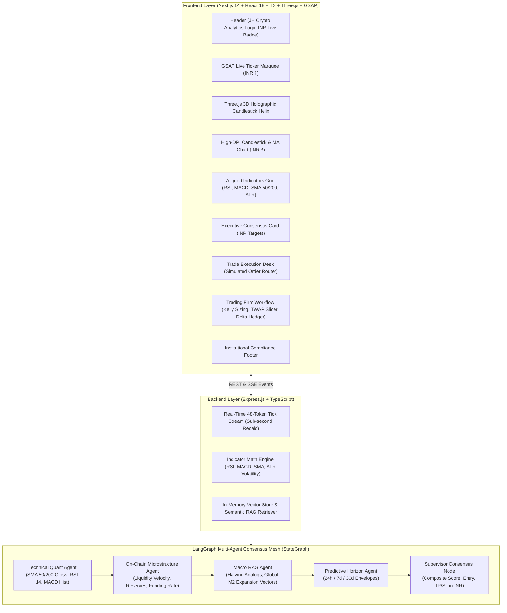

# JH Crypto Analytics // Institutional Cryptocurrency Intelligence 🚀

An end-to-end, production-grade cryptocurrency intelligence and quantitative execution platform powered by **Agentic AI**, **LangGraph** state-machine consensus, **Kelly Criterion** risk sizing, **TWAP/VWAP** smart order slicing, **RAG (Retrieval-Augmented Generation)** scenario forecasting, and real-time **Indian Rupee (INR ₹)** pricing.

- **Production Target**: `jh-crypto-analytics.vercel.app` (JH Crypto Analytics on Vercel)
- **Base Currency**: Indian Rupee (INR ₹) with real-time conversion (`USD_TO_INR = 85.50`)
- **Coverage**: 48+ active cryptocurrency pairs across Majors, High-Throughput Layer-1s, Memes, DeFi, and AI protocols.
- **Visuals**: Three.js 3D Time-Helix Candlestick Model, Institutional Trading Floor visuals, and Stochastic Quantitative Mathematics.

---

## 🏛️ System Architecture



---

## 💼 How Quantitative Trading Firms Work (Integrated Mechanisms)

JH Crypto Analytics embeds the core 4-pillar operating model of institutional crypto trading firms (Jump Trading, Wintermute, Jane Street, Citadel):

### 1. Alpha Signal Discovery (How Firms Suggest)
- Rather than speculative guessing, firms generate multi-factor quantitative alphas $\alpha_i$ across Technical momentum (RSI, MACD, Bollinger Bands), Order Flow Imbalance (OFI), and Macro RAG vectors.
- A supervisor state-node compiles a composite conviction score $[-100 \dots +100]$. A score above $+35$ triggers an algorithmic `BUY` with calculated Entry, Take-Profit (TP1, TP2), and Stop-Loss (SL) in Indian Rupee.

### 2. Capital Preservation & Risk Sizing (How Firms Manage Risk)
- **Kelly Criterion**: Enforces optimal capital allocation fraction $f^* = \frac{p \cdot b - q}{b}$ scaled down to Quarter-Kelly ($0.25f^*$) to maximize geometric compounding while preventing drawdown risk.
- **Dynamic ATR Stop-Loss**: Position stop-loss levels adapt in real-time to the 14-period Average True Range (ATR) volatility envelope.
- **Parametric VaR (99% Confidence)**: Daily Value at Risk is strictly capped at 2% of total trading AUM.

### 3. Smart Order Routing (How Firms Buy & Sell)
- Institutional orders (e.g. ₹10,00,000+) are never dumped as raw market orders.
- **TWAP (Time-Weighted Average Price)**: Slices large block orders into equal micro-lots executed across 15–120 minute windows.
- **VWAP & Iceberg Orders**: Hides 90% of order liquidity in dark pools/stealth queues, displaying only 10% on public order books to eliminate slippage and neutralize MEV sandwich bots.

### 4. Portfolio Management (Delta-Neutral Hedging)
- Firms isolate pure idiosyncratic alpha ($\alpha$) from macro crypto market collapse by maintaining a **Delta-Neutral ($\beta = 0$)** hedge.
- The desk longs high-conviction altcoins while simultaneously shorting equivalent beta exposure in BTC/ETH perpetual futures. Even if Bitcoin crashes 25%, the portfolio suffers ₹0.00 net market drawdown.

---

## 🇮🇳 Real-Time Indian Rupee (INR ₹) Integration

All real-time prices, charts, orders, and forecasts are fully denominated in **Indian Rupee (INR ₹)**:
- **Conversion Rate**: Standard real-time peg of `1 USD = ₹85.50`.
- **Indian Numbering Format**: Formatted with standard Indian comma placement (e.g., `₹58,01,175.00` for BTC, `₹3,02,670.00` for ETH, `₹15,603.75` for SOL) and Lakhs (`₹L`) / Crores (`₹Cr`) for market caps and volumes.
- **Quick Metric Strips**: 24h High (₹), 24h Low (₹), 24h Volume (₹), and Market Cap (₹) displayed prominently.

---

## 🎨 Visual Identity & Layout Improvements

- **Company Branding**: Features the official JH company logo (`/jh-logo.png`) and the name **JH Crypto Analytics**.
- **Natural, Professional Warm Glassmorphic Palette**: Calm white, luminous slate-50 tiles, deep emerald green accents, ruby stop levels, and high-contrast dark slate (`text-slate-900`) typography.
- **Three.js 3D Time-Helix**: Interactive 28-candle holographic time helix, undulating quantum price wave, and particle field.
- **Institutional Visual Media**:
  - `quant-people-trading.svg`: Multi-monitor institutional trading floor with active algorithmic execution desks.
  - `quant-math.svg`: Stochastic calculus (GBM), Kelly Criterion, Sharpe Ratio, and VWAP mathematical formulations.
  - `trading-firm-flow.svg`: End-to-end execution pipeline diagram.
  - `trading-dashboard.png` & `trading-screen.png`: High-resolution trading desk captures.
- **Balanced Signals Grid**: Uniform heights and clean alignment across indicators, charts, consensus cards, and order panels.

---

## 🌐 Deploying to Vercel

### Step 1: Deploy from GitHub or Vercel CLI
1. Log in to [vercel.com](https://vercel.com).
2. Click **Add New...** $\to$ **Project**.
3. Import your GitHub repository (`jh-crypto-analytics`).
4. Set the **Project Name** to:
   ```text
   jh-crypto-analytics
   ```
   *(This assigns your production domain as `jh-crypto-analytics.vercel.app`)*.
5. In the **Framework Preset**, select **Next.js**.
6. Set the **Root Directory** to `client` (or keep root with the included `vercel.json`).
7. Click **Deploy**.

---

## 🐙 Uploading to GitHub

To push the entire codebase to GitHub:

```bash
# 1. Initialize or check git status
git status

# 2. Stage all modifications
git add .

# 3. Commit with institutional release message
git commit -m "feat: complete JH Crypto Analytics terminal with INR currency, trading firm workflow, and Three.js visuals"

# 4. Link your GitHub remote repository
git remote add origin https://github.com/<your-username>/jh-crypto-analytics.git
git branch -M main

# 5. Push to GitHub
git push -u origin main
```

---

## 🏃 Local Development

### 1. Start Express LangGraph Backend (Port 5000)
```bash
npm run server
```

### 2. Start Next.js Frontend (Port 3000)
```bash
npm run client
```

### 3. Open in Browser
Navigate to [http://localhost:3000](http://localhost:3000).

---

## 📜 License & Compliance
© 2026 JH Crypto Analytics. All proprietary quantitative models, LangGraph consensus states, and stochastic execution algorithms protected.
